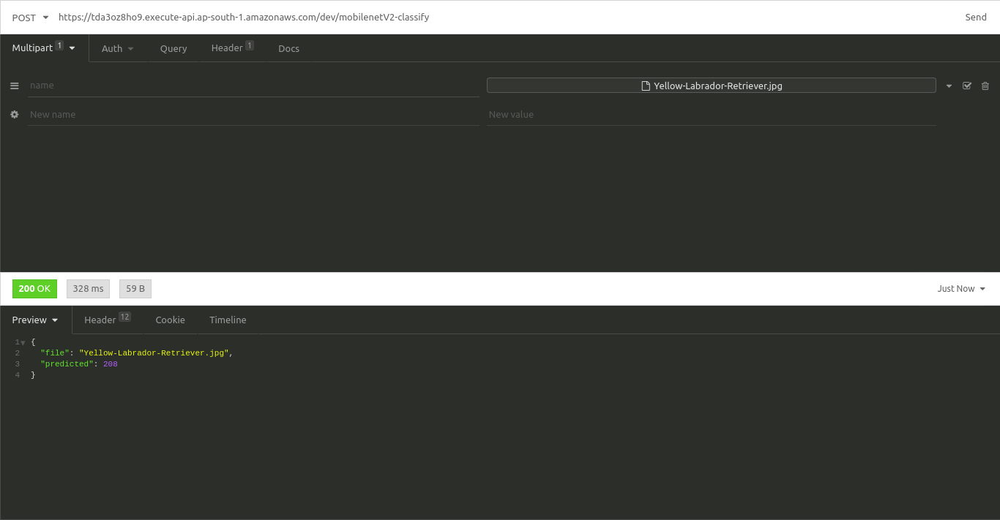

## Assignment 1:

When i pass the [Image](./Assignment/Yellow-Labrador-Retriever.jpg), to the model which is the AWS S3, the lambda function calls the model and pass the image as Input and it returned the predicted value : 208 as output, and it got displyed in the Insomnia, which is showed below.

## Output :
      {
        "file": "Yellow-Labrador-Retriever.jpg",
        "predicted": 208
      }
