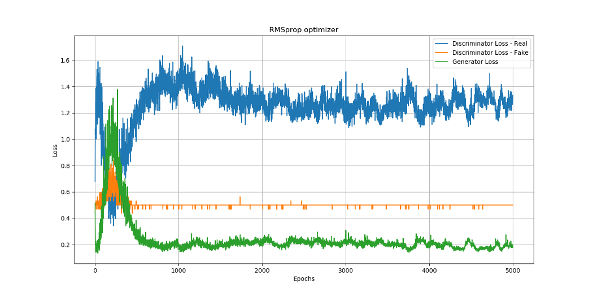
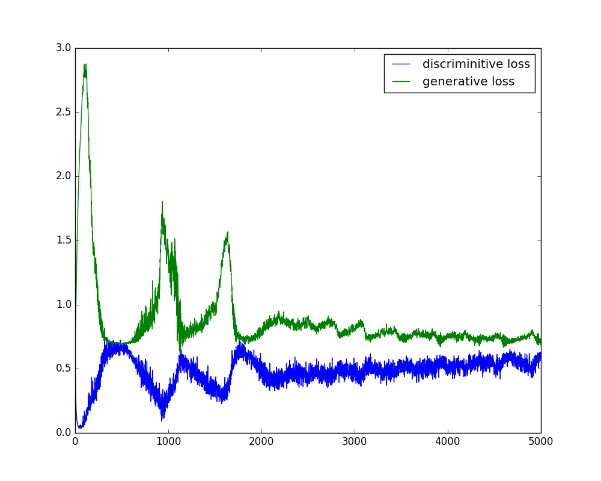

<h1 id=applications align='center'> GAN Applications </h1>

- **1. Generate Examples for Image Datasets**
- **2. Generate Photographs of Human Faces**
- **3. Generate Realistic Photographs**
- **4. Generate Cartoon Characters**
- **5. Image-to-Image Translation**
- **6. Text-to-Image Translation**
- **7. Semantic-Image-to-Photo Translation**
- **8. Face Frontal View Generation**
- **9. Generate New Human Poses**
- **10. Photos to Emojis**
- **11. Photograph Editing**
- **12. Face Aging**
- **13. Photo Blending**
- **14. Super Resolution**
- **15. Photo Inpainting**
- **16. Clothing Translation**
- **17. Video Prediction**
- **18. 3D Object Generation**

<h1 id=code align='center'> GAN via Code </h1>
 
A stable GAN will have a discriminator loss around 0.5, typically between 0.5 and maybe as high as 0.7 or 0.8. The generator loss is typically higher and may hover around 1.0, 1.5, 2.0, or even higher.

The accuracy of the discriminator on both real and generated (fake) images will not be 50%, but should typically hover around 70% to 80%.

**References:**

- [Training GANs using Google Colaboratory!](https://towardsdatascience.com/training-gans-using-google-colaboratory-f91d4e6f61fe)
 
https://colab.research.google.com/github/smartgeometry-ucl/dl4g/blob/master/gan.ipynb#scrollTo=NRMryrDVLFrr

https://github.com/Yangyangii/GAN-Tutorial/blob/master/CARS/DCGAN.ipynb 

https://github.com/Yangyangii/GAN-Tutorial/blob/master/CelebA/R1GAN.ipynb
  
  
  
  
  
  
  
  
 
  
  
