## 6. GANs: Generative Adversarial Network and Variants

### [Session 6 - GANs](https://www.youtube.com/watch?v=k5_nTSHpKv8)

**week 6 contents:**

- [What Are GANS?](./README.md/#gan_intro)

- [Deep Generative Models](./README.md/#dgm)

- [Overview of different Generative Models](./README.md/#overview)

- [GENERATIVE ADVERSARIAL NETWORKS](./README.md/#gan)

- [Generative VS Discriminative Algorithms](./README.md/#algos)

- [GAN Internals](./README.md/#gan_internals)

- [GANS, AUTOENCODERS AND VAES](./README.md/#gan_vaes)

- [GAN via code](./README.md/#code)

- [Types of GANS](./README.md/#types)

    - [DEEP CONVOLUTIONAL GAN (DCGAN)](./README.md/#dcgan)

    - [CONDITIONAL GAN](./README.md/#cgan)

    - [AUXILLARY GANS](./README.md/#agan)

    - [INFOGANS](./README.md/#infogan)

    - [PIXELGANS](./README.md/#pixelgan)

    - [CYCLEGANS](./README.md/#cyclegan)

- [GAN Problems](./README.md/#problems)

- [Assignment](./ASSIGNMENT.md/#assignment)

<h1 id=gan_intro align='center'>What Are GANS? </h1>

**`Adversarial: (of a trial or legal proceedings) in which the parties in a dispute have the responsibility for finding and presenting evidence.`**

- GANs are DNNs comprised of two nets, pitted one against the other (thus adversarial)

- Generative Adversarial Networks are deep neural net architectures comprised of two neural networks, competing one against the other (adversarial = competing).

- GANs are neural networks that are trained in an adversarial manner to generate data mimicking some distribution.

[GAN Applications](./CONTENT.md/#applications)

## Two great practical examples of GAN use are:

**Google Brain Project for Creating a Method of Encryption :**

    The project was to send an encrypted message which cannot be intercepted by anyone. 

**Drug Research :**

    Drug Research, can be trained on existed drugs and suggest new synthetic chemical structures that improve upon existing drugs.
 

## There are two kinds of models in machine learning:

**`Discriminative model:`**
   
- They discriminate between two classes of data (for example hot-dog, not-hot-dog, i.e. 0/1). They fall into the category of classification problems. 
    
**`Generative models:`**

- They are trained on training data X sampled from a distribution D, which given some random distribution z produces a distribution D' which is close to D according to some closeness metrics. 

<h1 id=dgm align='center'> Deep Generative Models </h1>

- AutoEncoders

- Variational AutoEncoders

- Ganerative Adversarial Networks
    
        Adversarial AutoEncoders

        VAE/GAN

        Adversatial Domain Adaption

<h1 id=overview align='center'> Overview of different Generative Models </h1>

<h2 align='center'> Auto Encoders </h2>

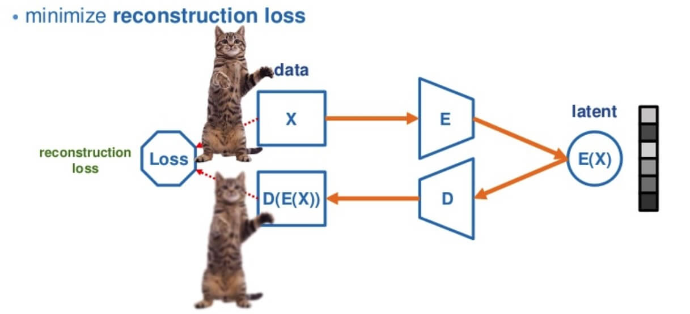

<h2 align='center'> Variational Auto Encoders </h2>

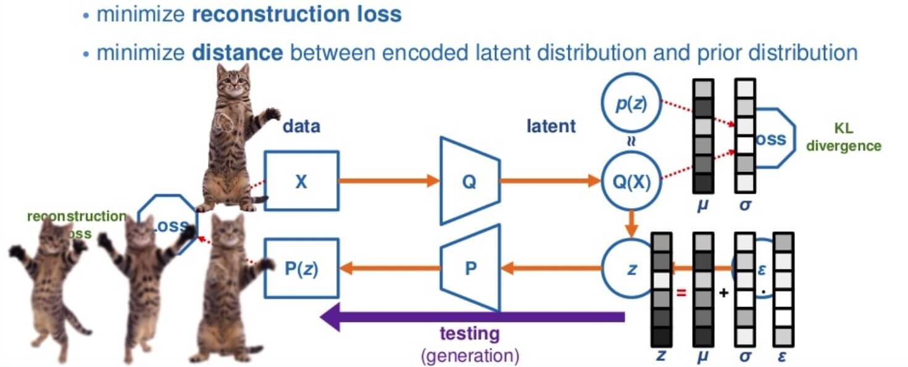

<h2 align='center'> GANs </h2>

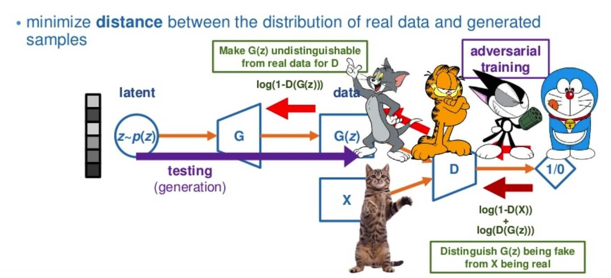

<h1 id=gan align='center'> GENERATIVE ADVERSARIAL NETWORKS </h1>

- GANs were introduced in a [paper](./Papers/Generative_Adversarial_Nets.pdf) by **Ian Goodfellow and other researchers at the University of Montreal, including Yoshua Bengio, in 2014**. Referring to GANs, Facebook’s AI research director **Yann LeCun** called [adversarial training](https://www.quora.com/What-are-some-recent-and-potentially-upcoming-breakthroughs-in-deep-learning) “the most interesting idea in the last 10 years in ML.”

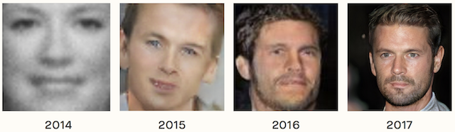

#### Practical Examples:

- GANs’ potential is huge, because they can learn to mimic any distribution of data. That is, GANs can be taught to create worlds eerily similar to our own in any domain: images, music, speech, prose. They are robot artists in a sense, and their output is impressive – poignant even.

- In a surreal turn of events, [Christie’s sold a portrait](https://www.theverge.com/2018/10/23/18013190/ai-art-portrait-auction-christies-belamy-obvious-robbie-barrat-gans) for $432,000 that had been generated by a GAN, based on [open-source code written by Robbie Barrat of Stanford](https://github.com/robbiebarrat/art-DCGAN). Like most true artists, he didn’t see any of the money, which instead went to the French company, Obviously.

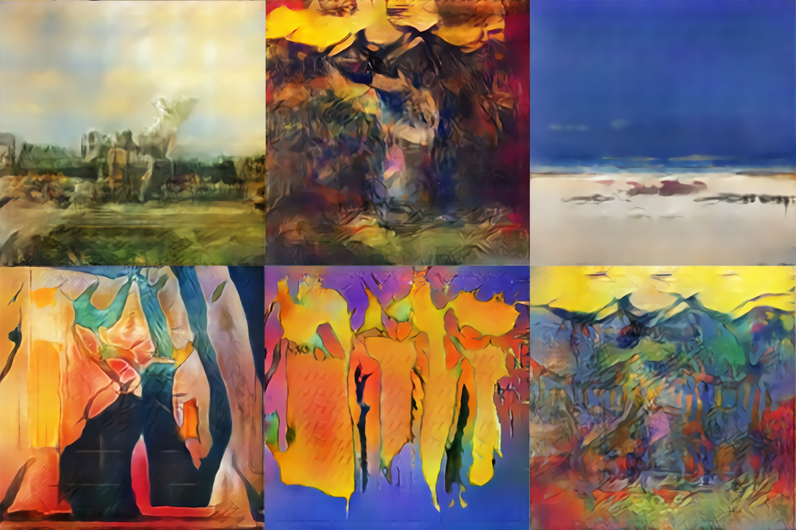

<h1 id=algos align='center'> GENERATIVE VS DISCRIMINATIVE ALGORITHMS </h1>

To understand GANs, you should know how generative algorithms work, and for that, contrasting them with discriminative algorithms is instructive. Discriminative algorithms try to classify input data; that is, given the features of an instance of data, they predict a label or category to which that data belongs.

- A Discriminative algorithm could predict whether a given image is Dog or a Cat, and it does that by learning the features that constitute the input image. So a DA maps features to labels. They are concerned solely with that correlation. 

- Generative algorithms, on the other hand, try to do the opposite. Instead of predicting a label given a certain image, they attempt to predict the image given a certain label. 

*Another way to think about it is to distinguish discriminative from generative like this:*

    Discriminative models learn the boundary between classes

    Generative models model the distribution of individual classes
    
<h1 id=gan_internals align='center'> GAN INTERNALS </h1>
 
**`One neural network, called the generator, generates new data instances, while the other, the discriminator, evaluates them for authenticity; i.e. the discriminator decides whether each instance of data that it review belongs to the actual training dataset or now.`**

We’re going to generate hand-written numerals like those found in the MNIST dataset, which is taken from the real world. The goal of the discriminator, when shown an instance from the true MNIST dataset, is to recognize those that are authentic.Meanwhile, the generator is creating new, synthetic images that it passes to the discriminator. It does so in the hopes that they, too, will be deemed authentic, even though they are fake. 

- *The goal of the generator is to generate passable hand-written digits:*

        to lie without being caught. 

- *The goal of the discriminator is to identify images coming from the generator as fake.*

*Here are the steps a GAN takes:*

- The generator takes in random numbers and returns an image
    
- This generated image is fed into the discriminator alongside a stream of images taken from the actual, ground-truth dataset
    
- The discriminator takes in both real and fake images and returns values between 0 and 1, with 1 representing a prediction of authenticity and 0 representing a fake. 
 
*So you have a double feedback loop:*

- The discriminator is in a feedback loop with the ground truth of the images, which we know.

- The generator is in a feedback loop with the discriminator.

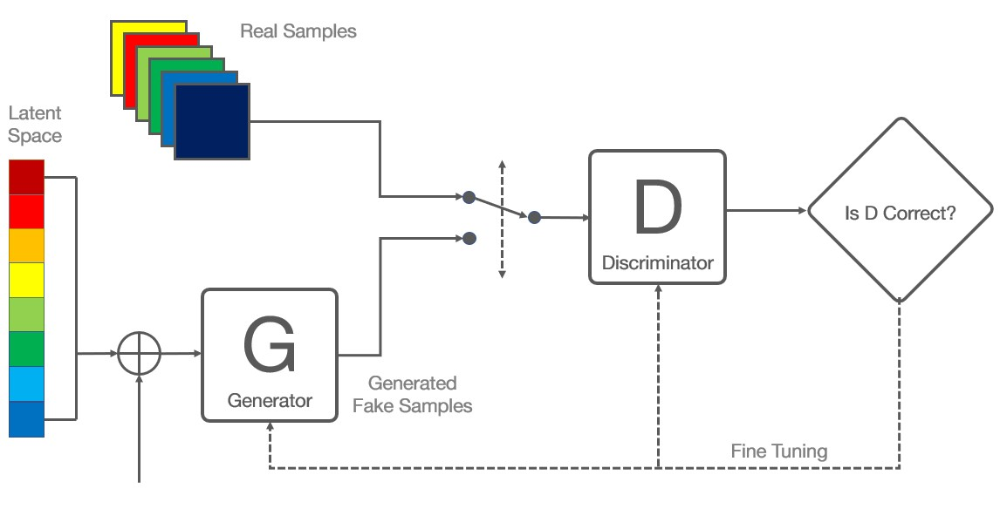

<h3 align='center'> Actual Example: </h3>

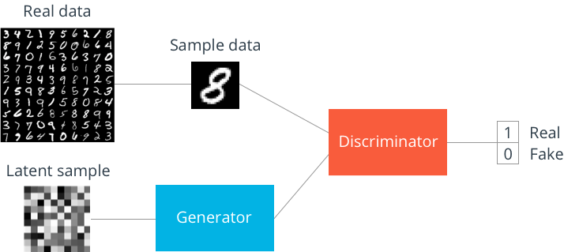

    Real and Fake are values 1 and 0. We are targeting 0.5. 

- we can think of a GAN as the opposition of a counterfeiter and a cop in a game of cat and mouse, where the counterfeiter is learning to pass false notes, and the cop is learning to detect them. Both are dynamic; i.e. the cop is in training, too (to extend the analogy, maybe the central bank is flagging bills that slipped through), and each side comes to learn the other’s methods in a constant escalation.

*Let us consider MNIST;*

- For MNIST, the discriminator network is a standard convolution network that can categorize the images fed to it, a binomial classifier labeling images as real or fake. 

- The generator is an inverse convolution network. While a standard convolution classifier takes an image and down-samples it to produce a soft-max number, the generator model takes a vector of random noise and up-samples it to an image. 

The first throws away the data through down-sampling techniques like max-pooling, and the second generates new data. 

- ***Both networks are trying to optimize a different and opposing objective function, or loss function, in a zero-sum game. This is essentially an actor-critic model. As the discriminator changes its behavior, so does the generator, and vice versa. Their losses push against each other.***

Our Discriminator and Generator can take many DNN forms, most of which we already are aware of:

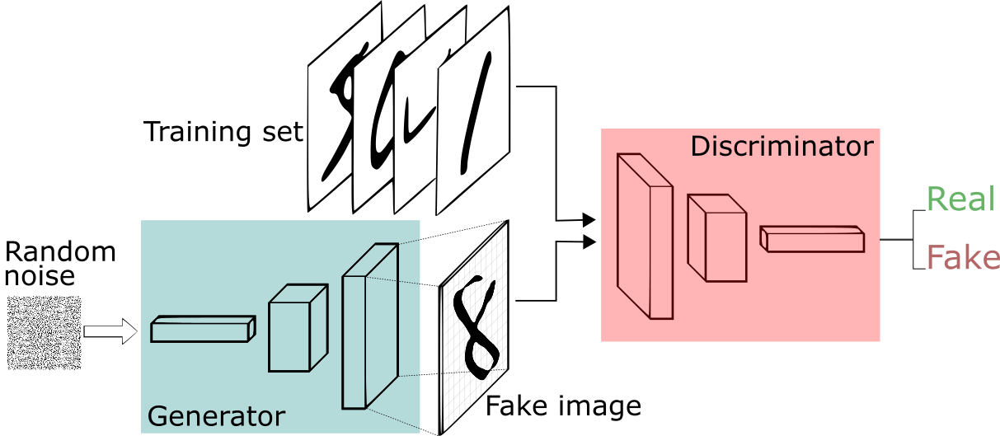

<h1 id=gan_vaes align='center'> GANS, AUTOENCODERS AND VAES </h1>

*`It may be useful to compare generative adversarial networks to other neural networks, such as autoencoders and variational autoencoders.`*

**Autoencoders:**

- Autoencoders encode input data as vectors. They create a hidden or compressed representation of the raw data. They are useful in dimensionality reduction; that is, the vector serving as a hidden representation compresses the raw data into a smaller number of salient dimensions. Autoencoders can be paired with a decoder, which allows you to reconstruct input data based on its hidden representation.

**Variational Autoencoders:**

- Variational Autoencoders are generative algorithms that add an additional constraint to encode the input data, namely that the hidden representations are normalized. VAEs are capable of both compressing data like an autoencoder and synthesizing data like a GAN. However, while GANs generate data in fine, granular details, images generated by VAEs tend to be more blurred (this statement changed on [9 June 2019 paper](./Papers/Generating_Diverse_High_Fidelity Images_VQ_VAE_2.pdf))

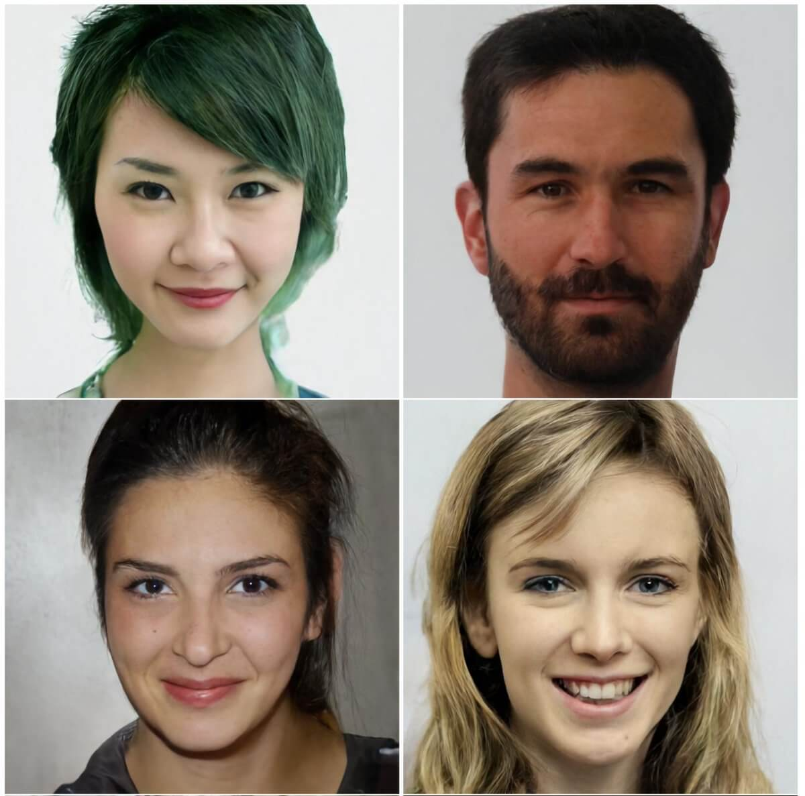

**GANs:**

- When you train the discriminator, hold the generator values constant, and when you train the generator, hold the discriminator constant. You need to train the discriminator first. You also need to train the discriminator more than the generator. 

- Each side of the GAN can overpower the other. If the discriminator is too good, it will return values so close to 0 or 1, that the generator will struggle to read the gradient. If the generator is too good, it will persistently exploit a weakness in the discriminator that lead to false negatives. This may be mitigated by their respective learning rates. 

**GANs take a long time to train. On a single GPU a GAN might take hours and on a single CPU more than a day.**

<h1 id=code align='center'> GAN VIA CODE </h1>

[GAN code](./CONTENT.md/#code)

<h1 id=types align='center'> TYPES OF GANS </h1>

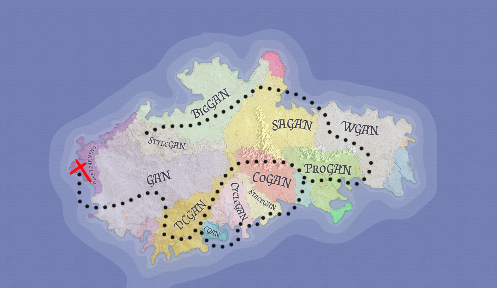

<h2 id=dcgan align='center'> 1. DEEP CONVOLUTIONAL GAN (DCGAN) </h2>

- [Paper](./Papers/DCGAN.pdf)

- [Code](https://github.com/floydhub/dcgan)

- Other great resources: [Medium article](https://naokishibuya.medium.com/up-sampling-with-transposed-convolution-9ae4f2df52d0)

***`The core idea is we use a convolutional neural network instead of a vanilla neural network at both discriminator and generator.`***

        Convolutions  =  Good for images

        GANs  =   Good for generating stuff

        ⟹ Convolutions + GANs = Good for generating images
        
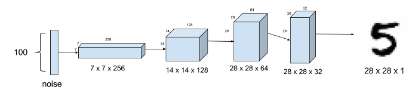

<h2 id=cgan align='center'> 2. CONDITIONAL GAN </h2> 

- [Paper](./Papers/CGAN.pdf)

- [Code](https://github.com/PacktPublishing/Advanced-Deep-Learning-with-Keras)

- Other great resources: [Blog Post](https://wiseodd.github.io/techblog/2016/12/24/conditional-gan-tensorflow/)

***`The core idea is to train a GAN with a conditioner, e.g. for MNIST data, we provide the label as well.`***

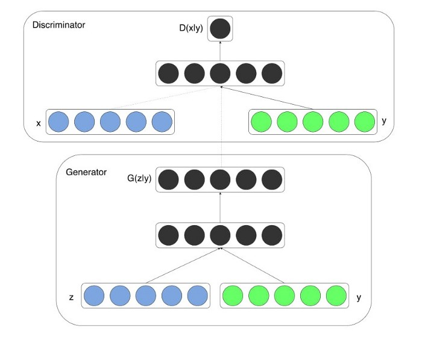

        we can generate both cats and dogs from the very same GAN. 🐈 🐕
        
<h2 id=agan align='center'> 3. AUXILLARY GANS </h2>  

Every generated sample has a corresponding class label:

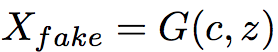
    
- Think of ACGAN as CGAN except D is not told about the label, though the additional network is added to give class probs at D.

<h2 id=infogan align='center'> 4. INFOGANS </h2>

We seed GAN with random noise. We are not sure what is generating what. This is spooky. Can we change this? can we untangle this?

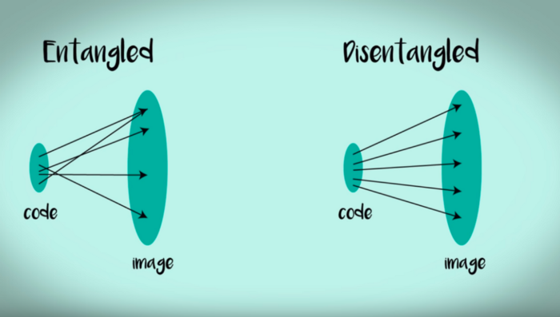

    1. Take a separate network called Q.
    
    2. Pick a random number (say x, like a label)
    
    3. Feed it to G, along with the noise
    
    4. Train D as you'd
    
    5. Feed the image generated by G and make Q network predict x
    
<h2 id=pixelgan align='center'> 5. PIXELGANS </h2>  

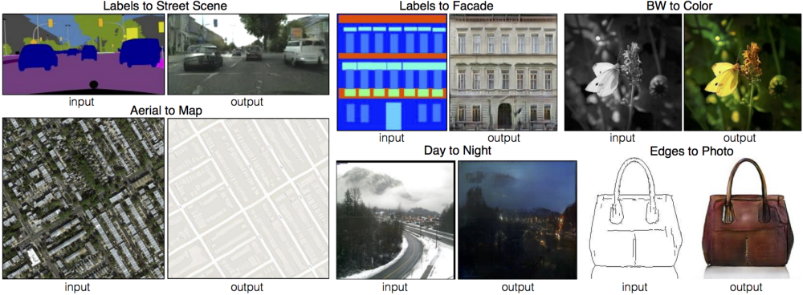

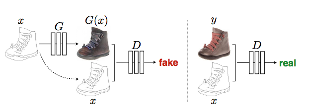

    Basically feed both the image to both the networks. 
    
<h2 id=cyclegan align='center'> 6. CYCLEGANS </h2>  

- [Paper](./Papers/Cycle_gan.pdf)

- [Code](https://github.com/junyanz/CycleGAN)

- Other great resources: [CycleGAN project page](https://junyanz.github.io/CycleGAN/), [Medium article](https://towardsdatascience.com/turning-fortnite-into-pubg-with-deep-learning-cyclegan-2f9d339dcdb0)

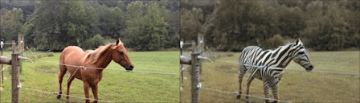

    1.Take the 2 images x and y (1 from Domain X and 1 from Domain Y )
    
    2. Run the two generators (x2y and y2x) → generate 2 fake images(y’,x’)
    
    3. Run the two discriminators (DX and DY ) DX takes x and x’ , DY takes y and y’
    
    4. Calculate the discriminator's losses from the above equations
    
    5. Run again the two generators, x2y (x’ as the input) and y2x (y’ is the input) generates two-cycle images (y_cycle, and x_cycle)
    
    6. Calculate the cycle l1 loss from (x,x_cycle and y,y_cycle)
    
    7. Finally, calculate the generator loss
    
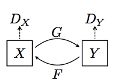

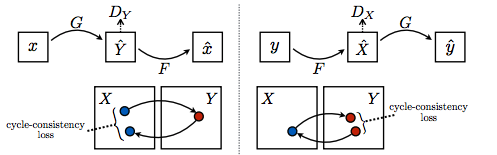

<h1 id=problems align='center'> GAN PROBLEMS </h1>

***Many GAN models suffer the following major problems:***

       1. Non-convergence: the model parameters oscillate, destabilize and never converge,

- ***2. Mode collapse: the generator collapses which produces limited varieties of samples,***

       3. Diminished gradient: the discriminator gets too successful that the generator gradient vanishes and learns nothing,

       4. Unbalance between the generator and discriminator causing overfitting, &

       5. Highly sensitive to the hyperparameter selections.

### Model Collapse :

- Real-life data distributions are multimodal. For example, in MNIST, there are 10 major modes from digit ‘0’ to digit ‘9’. The samples below are generated by two different GANs. The top row produces all 10 modes while the second row creates a single mode only (the digit “6”). This problem is called mode collapse when only a few modes of data are generated.

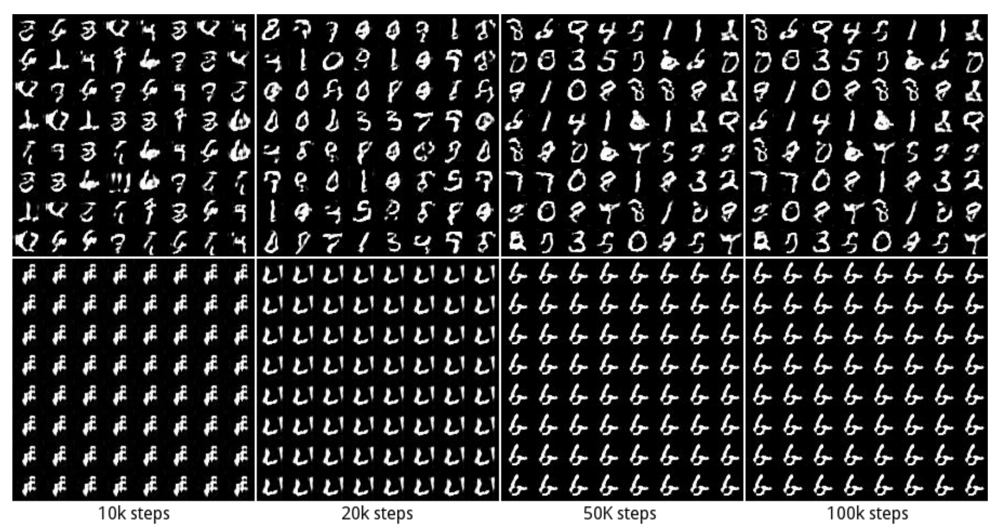
